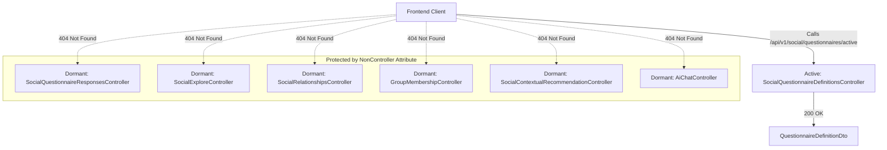
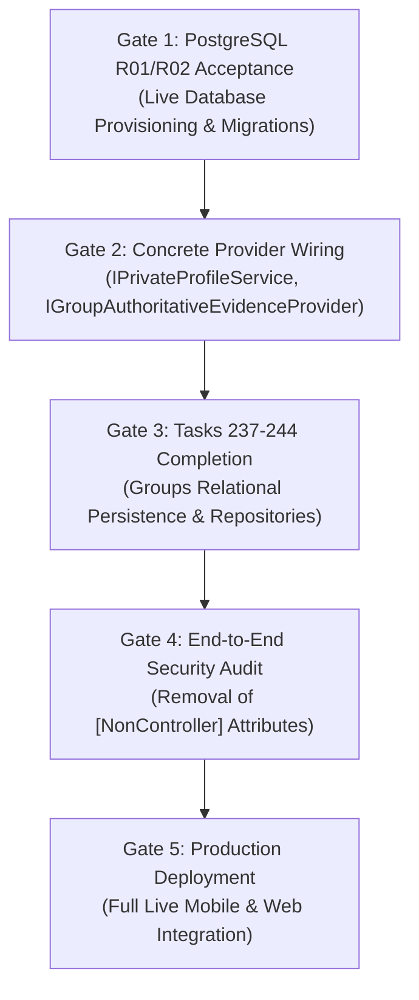

# ANDRIL M5 — FRONTEND API READINESS CONTRACT & ACTIVATION BOUNDARIES
## Technical Reference for ANDRIL Mobile (Flutter) & Web (Angular) Frontend Teams

> **DOCUMENT CLASSIFICATION:** Architecture & API Integration Documentation Deliverable (Task 254)  
> **DATE:** 2026-11-25  
> **DOMAIN / AUTHORITY:** M5 — Social Domain, Matching & Groups (Thulaanchan)  
> **REPOSITORY:** `E:\Andril-Backend`  
> **BRANCH:** `Member-5`  
> **INTEGRATION TARGET:** `Develop`  
> **GOVERNING GATES:** Relational Gates R01/R02 Deferred; Policy Gates P-04/P-06/P-07/P-10 Pending  

---

## 1. Executive Summary & Purpose

This contract establishes the authoritative backend integration reference for the ANDRIL frontend development teams (Flutter Android/iOS client and Angular Administration console). It specifies:

1. The exact **currently active and verified production API endpoint** provided by Member-5.
2. The exact **approved request and response DTO schemas**, serialization boundaries, and security headers.
3. The comprehensive inventory of **dormant controllers** that are strictly excluded from runtime MVC dispatch via `[NonController]`.
4. The architectural boundaries, upstream member dependencies (M2, M4, M6), deferred tasks (Tasks 237–244), and required production activation gates.

> [!IMPORTANT]
> **PROHIBITION AGAINST CALLING DORMANT CONTROLLERS:** Frontend clients must not treat dormant controllers (such as `/api/v1/social/explore`, `/api/v1/social/questionnaires/responses`, `/api/v1/social/relationships`, `/api/v1/groups`, or `/api/v1/social/ai/recommendations`) as live backend endpoints. Because they are annotated with `[NonController]` in production, ASP.NET Core MVC routing ignores them, and any HTTP request to those routes will return `404 Not Found`.

---

## 2. Active Production Endpoint Inventory

The only active, routed, and DI-registered M5 endpoint in the current production configuration (`Program.cs`) is the Questionnaire Definitions endpoint:

| Method | Path | Controller | Authorization | Status |
|---|---|---|---|---|
| `GET` | `/api/v1/social/questionnaires/active` | `SocialQuestionnaireDefinitionsController` | `[Authorize]` | **LIVE & ACTIVE** |

### 2.1 Endpoint Specification: `GET /api/v1/social/questionnaires/active`

- **Route:** `api/v1/social/questionnaires/active`
- **HTTP Method:** `GET`
- **Controller:** `Andril.API.Controllers.Social.SocialQuestionnaireDefinitionsController`
- **Service Dependency:** `ISocialQuestionnaireDefinitionAccessService` (resolved via `AddSocialQuestionnaireServices()` in `Program.cs`)
- **Authentication & Authorization:**
  - Requires valid JWT Bearer token in the `Authorization: Bearer <token>` header.
  - Caller subject (`sub`) or profile identity must be present in claims.
  - Unauthenticated requests return `401 Unauthorized`.
  - Callers failing token validation or account standing policies return `403 Forbidden`.
- **Cache-Control Header:**
  - Enforced via `[ResponseCache(NoStore = true, Location = ResponseCacheLocation.None)]`.
  - Response headers include: `Cache-Control: no-store, no-cache, max-age=0`.
- **Request Parameters:** None.
- **Request Body:** None.

### 2.2 Approved Response DTO Schema (`QuestionnaireDefinitionDto`)

Upon success (`200 OK`), the endpoint returns the canonical questionnaire definition for client rendering:

```json
{
  "version": "v1.0",
  "questions": [
    {
      "id": "q01",
      "prompt": "How do you prefer to spend your free weekends?",
      "isRequired": true,
      "options": [
        { "id": "1", "label": "Exploring outdoors or traveling to new places" },
        { "id": "2", "label": "Social gatherings, dinner parties, or events with friends" },
        { "id": "3", "label": "Relaxing at home with books, movies, or solo hobbies" },
        { "id": "4", "label": "Working on creative personal projects or learning new skills" }
      ]
    },
    {
      "id": "q02",
      "prompt": "When meeting new people in a social setting, you typically:",
      "isRequired": true,
      "options": [
        { "id": "1", "label": "Introduce yourself proactively and start conversations" },
        { "id": "2", "label": "Wait for others to approach you or warm up gradually" },
        { "id": "3", "label": "Prefer deep one-on-one discussions over group chatter" },
        { "id": "4", "label": "Observe the atmosphere before actively engaging" }
      ]
    }
  ]
}
```

#### DTO Field Specifications:

| JSON Property | Type | Nullable | Description |
|---|---|---|---|
| `version` | `string` | No | Authoritative questionnaire version identifier (e.g. `"v1.0"`). Must be transmitted with submissions. |
| `questions` | `array` | No | Immutable list of canonical questionnaire questions in display order. |
| `questions[].id` | `string` | No | Canonical question key (e.g. `"q01"`, `"q02"`). Used for answer mapping. |
| `questions[].prompt` | `string` | No | User-facing localized question text prompt. |
| `questions[].isRequired` | `boolean` | No | Flag indicating whether this question must have a chosen option before submission. |
| `questions[].options` | `array` | No | Immutable list of available options for this question. |
| `questions[].options[].id` | `string` | No | Canonical option key (e.g. `"1"`, `"2"`). Transmitted as `optionId` upon response submission. |
| `questions[].options[].label` | `string` | No | User-facing localized option label text. |

### 2.3 Frontend Client State Handling

Frontend clients integrating with `GET /api/v1/social/questionnaires/active` must implement the following state transitions:

1. **Loading State:** Display localized skeleton shimmer or loading indicator while HTTP request is in-flight.
2. **Success State (`200 OK`):**
   - Store `version` in questionnaire flow state.
   - Render questions sequentially with radio buttons or single-choice selection cards based on `options`.
   - Prevent client progression until all questions with `isRequired: true` have an option selected.
3. **Empty / Unavailable State:** If `questions` array is empty (e.g., catalog maintenance), render localized fallback: *"Personality questionnaire is temporarily unavailable."*
4. **Unauthorized State (`401 Unauthorized`):** Refresh authentication token or redirect to login flow.
5. **Forbidden State (`403 Forbidden`):** Display error banner indicating account standing or age restrictions prevent Social participation.
6. **Network / Server Error (`5xx`):** Provide a *"Retry"* action with exponential backoff; do not crash UI.

---

## 3. Actual Response Serialization Boundaries

All M5 API responses enforce strict privacy and serialization boundaries:

- **Naming Policy:** Standard camelCase property naming.
- **Diagnostic Confidentiality:** Internal server stack traces, database identifiers, SQL error messages, raw exception strings, and sensitive property diagnostics are strictly suppressed (Task 248).
- **Prohibited Data Surfaces:**
  - No account email addresses, phone numbers, or authentication passwords.
  - No database surrogate primary keys (`Id` long/int identity columns).
  - No raw personality dimension scoring formulas, internal psychological traits, or confidential cluster weights.
  - All sensitive matching entities and cards enforce `[JsonIgnore]` on diagnostic properties, returning `{}` if inadvertently serialized.

---

## 4. Dormant Controller Inventory & Production Non-Activation Boundaries

The following controllers exist in the codebase for offline contract verification, unit testing, and architectural preparation, but are **explicitly dormant in production** via `[NonController]`:



### 4.1 Detailed Dormancy Inventory

| Controller | Proposed Route | Protection Attribute | Reason for Dormancy |
|---|---|---|---|
| `SocialQuestionnaireResponsesController` | `/api/v1/social/questionnaires/responses` | `[NonController]` | Relational questionnaire response persistence and lifecycle access services not wired in production `Program.cs`. |
| `SocialExploreController` | `/api/v1/social/explore` | `[NonController]` | Production authoritative matching evidence provider, Redis cache, and live candidate repository unactivated. |
| `SocialRelationshipsController` | `/api/v1/social/relationships` | `[NonController]` | Mutual match persistence, reciprocal decision state store, and bidirectional blocking database tables not provisioned. |
| `GroupMembershipController` | `/api/v1/groups` | `[NonController]` | Relational group persistence deferred (Tasks 237–244); physical schema and cross-module transactions pending. |
| `SocialContextualRecommendationController` | `/api/v1/social/ai/recommendations` | `[NonController]` | Contextual recommendation AI provider and verified live evidence pipelines pending M6 integration. |
| `AiChatController` | Direct service invocation | `[NonController]` | Live AI streaming provider, middleware verification, and Section 05 security acceptance pending. |

---

## 5. Missing Authoritative Providers & Relational Repositories

Before any dormant controller can be activated for production, concrete implementations of the following interfaces must be implemented and registered:

1. **`IPrivateProfileService` (M2 Dependency):** Authoritative identity verification, age verification, active account standing, and profile opt-in resolution.
2. **`IQuestionnairePersistenceRepository` (M5 Social Persistence):** Relational storage for questionnaire responses (`social_questionnaire_responses`) and answer line items (`social_questionnaire_answers`).
3. **`ISocialMatchRepository` & `ISocialDirectionalInterestRepository` (M5 Matching Persistence):** Relational tables for reciprocal decisions, mutual match timestamps, and unmatch/block records.
4. **`IGroupEntryRepository`, `IGroupMembershipRepository`, `IGroupJoinRequestRepository` (M5 Groups Persistence):** Relational tables for group entries, memberships, and join requests.
5. **`IGroupAuthoritativeEvidenceProvider` (M5/M2 Groups Context):** Authoritative resolution of member identity, age, and module standing for group join operations.

---

## 6. Upstream Team Dependencies & Deferred Tasks

| Cross-Member Area | Upstream Owner | Current Status | Impact on M5 Frontend Delivery |
|---|---|---|---|
| **PostgreSQL Database** | M2 / Infrastructure | Gates R01/R02 Deferred | Live relational tables cannot be migrated to Supabase/PostgreSQL until gates are formally opened. |
| **User Profile Management** | M2 (Accounts/Onboarding) | Integrated Baseline | Profile creation, gender demographics, and photo storage are managed by M2 endpoints. |
| **Groups Persistence Tasks 237–244** | M5 / Team Lead | Deferred by Directive | Tasks 237–244 (EF Core models, physical schema migrations, and repositories) remain deferred. |
| **Real-time Match Chat** | M4 (Communication) | Integration In-Progress | Mutual match state (State 2) does not authorize chat access until M4 chat authorizer is coordinated. |
| **AI Model & Moderation** | M6 (AI & Moderation) | Scaffolding Only | Contextual recommendations and AI chat endpoints remain dormant pending M6 provider wiring. |

---

## 7. Outstanding Product & Governance Decisions

The following policy decisions remain pending Team Lead approval and must not be assumed by frontend clients:

- **Decision P-04:** Maximum number of active Social Zones a user may join simultaneously (proposed: 5).
- **Decision P-06:** Mutual match notification mechanism (push notification vs in-app badge vs silent discovery refresh).
- **Decision P-07:** Age disparity guardrails for Social discovery (strict reciprocal age bands vs server-side default ±5 years).
- **Decision P-10:** Questionnaire retake cooldown interval (proposed: 30 days between full retakes).

---

## 8. Development Fixtures vs Production Activation Gates

For local UI testing and Flutter widget development, frontend teams may mock questionnaire responses or use offline contract test fixtures. However, production readiness requires passing the following mandatory gates:



1. **Gate 1 (Database Provisioning):** PostgreSQL daemon and Supabase connection verified under live network conditions.
2. **Gate 2 (Provider Wiring):** Concrete adapters replace offline development fixtures.
3. **Gate 3 (Tasks 237–244 Resolution):** Groups relational persistence and cross-module transactions approved.
4. **Gate 4 (Security Audit):** Verification that removing `[NonController]` does not expose unauthenticated or unprotected resources.
5. **Gate 5 (Production Deployment):** Integration tests pass against live staging backend.

---

## 9. Conclusion

Frontend engineers should immediately proceed with building the **Personality Questionnaire Presentation UI** against the active `GET /api/v1/social/questionnaires/active` endpoint. All other Social and Groups flows should maintain appropriate mock boundaries or disabled states until formal activation notices are published by Member-5 and the Team Lead.
