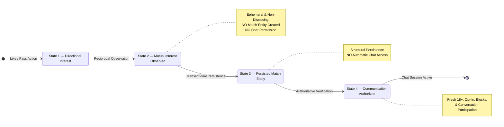

# ANDRIL M5 / M4 — SOCIAL MATCH COMMUNICATION READINESS CONTRACT
## Cross-Module Boundary Specification: Social Match Lifecycle, Communication Authorization & Chat Readiness

> **STATUS: PROPOSED CONTRACT / OFFLINE READINESS VERIFIED**  
> **Document Date:** 2026-11-24  
> **Authors:** M5 (Thulaanchan — Social Domain & Matching Lead) in collaboration with M4 (Communication & Chat)  
> **Repository:** `Andril-Backend`  
> **Branch Base:** `Develop`  
> **Stack:** ASP.NET Core / .NET 10 / C# 13  
> **Compliance:** BRD v2.4-R1 §04.1, §05.1, §11.1, §12.1, §16.2, §18.1, §20.1; SOC-01, SOC-02, CF-04, CF-05, CF-07, CF-11, CF-12, CF-18, CF-20  
> **Stakeholders:** M2 (Identity & Profile Standing), M4 (Communication & Messaging), M5 (Social Matching & Zones), M6 (Security & Release Review)

---

## 1. Executive Summary & Purpose

This contract document establishes the formal integration and security boundary between the **Social Matching domain (`Andril.Social`, M5)** and the **Communication domain (`Andril.Communication`, M4)**.

During offline development (Tasks 111–118), M5 verified core domain logic for Social candidate discovery, reciprocal interest evaluation, persisted match scoping, and Zone module isolation. However, to maintain strict architectural safety and comply with production security gates, **Social matching logic does not directly grant communication tokens, create chat conversations, or deliver messages.**

This document provides M4 engineering with the exact specifications, evidence requirements, state lifecycle definitions, and security invariants necessary to implement production chat authorization once database activation gates (R01–R08) are cleared.

---

## 2. Four Discrete Architectural States (CF-20 Boundary)

The ANDRIL platform enforces an absolute distinction between the four progressive states of connection. An entity or observation in any preceding state **never implies or grants** access to subsequent states.



### State 1: Directional Interest (`SocialDirectionalInterest`)
- **Domain Type:** `Andril.Social.Matching.SocialDirectionalInterest`
- **Semantics:** An isolated, one-sided interest decision (`IsPositive == true` for like, `false` for pass) recorded by an acting profile within a canonical pair (`SocialProfilePairKey`).
- **Security Boundaries:**
  - One-sided interest is strictly confidential. Target candidates are never notified of one-sided interest.
  - Acting profile must belong to the pair key; foreign profile identities throw `ArgumentException`.
  - Directional interest does **not** constitute a mutual match and does **not** grant chat, call, or messaging authorization.

### State 2: Mutual Interest Observed (`SocialReciprocalInterestEvaluator`)
- **Domain Types:** `SocialReciprocalInterestEvaluator`, `SocialPairInterestObservationService`
- **Semantics:** Pure offline observation indicating that both participants in a canonical profile pair have recorded explicit positive interest (`SocialReciprocalInterestStatus.MutualInterestObserved`).
- **Security Boundaries:**
  - Ephemeral evaluation over in-memory or retrieved directional signals.
  - Any negative interest returns `NotMutual`. Missing or null signal returns `Indeterminate`.
  - Observation result is strictly non-disclosing (`[JsonIgnore]` on all properties, `ToString()` returns `"SocialPairInterestObservationResult [private]"`).
  - **CRITICAL INVARIANT:** Mutual interest observation alone **does NOT create or persist a match entity** and **does NOT grant communication authorization**.

### State 3: Persisted Match Entity (`SocialMatchEntity`)
- **Domain Types:** `Andril.Social.Entities.SocialMatchEntity`, `ISocialMatchRepository`, `SocialMatchScopedLookupService`
- **Semantics:** Structural persistence candidate recording `MatchId`, canonical `SocialProfilePairKey`, and explicit `CreatedAtUtc`.
- **Security Boundaries:**
  - Scope-isolated retrieval via `SocialMatchScopedLookupService`: Lookups by third parties or mismatched profiles return `ProfileIdMismatch`.
  - Persistence of a match entity records relationship existence; it does **not** verify current real-time account standing, moderation bans, or unmatch revocations.
  - **CRITICAL INVARIANT:** A persisted match entity alone **does NOT grant chat access or generate conversation tokens**.

### State 4: Communication Authorization (`IChatAccessAuthorizer`)
- **Domain Types:** `Andril.Communication.Interfaces.IChatAccessAuthorizer`, `ChatAuthorizedActor`, `ChatConversationAccessEvidence`
- **Semantics:** Real-time, server-resolved verification proving that a specific authenticated user is permitted to read or send messages in a specific human-to-human conversation.
- **Security Boundaries:**
  - Requires fresh verification of M2 account identity, profile ownership, adult standing (18+), explicit Social opt-in, active mutual match, and zero bidirectional blocks.
  - In offline mode, `DenyAllChatAccessAuthorizer` strictly denies all requests (returns `null`), ensuring zero unauthorized communication pathways exist.

---

## 3. Communication Authorization Security Invariants

To safeguard user privacy and prevent unauthorized contact, M4 implementations must strictly adhere to the following security invariants:

### 3.1 Fail-Closed Authorization Policy
- Communication authorization must fail closed. Any missing, unrecorded, null, expired, or contradictory evidence must result in access denial (`null` `ChatAuthorizedActor`).
- Exceptions thrown during evidence retrieval or repository lookups must be caught and handled as authorization denial without disclosing exception details to clients.

### 3.2 Prerequisites for Social Chat Access
For `ChatModule.Social`, an access check must satisfy all of the following conditions simultaneously:
1. **Authenticated Actor:** Request context contains a verified subject (`AccountSubjectId`).
2. **Account Integrity:** Subject correlates to a valid internal `AccountId` with `ProfileAccountId == AccountId`.
3. **Module Profile Ownership:** Caller owns the private Social `ModuleProfileId` associated with the conversation.
4. **Adult Verification:** `IsAdult == true` (strictly 18+; underage profiles are permanently excluded from Social).
5. **Explicit Module Opt-In:** `HasSocialOptIn == true` (caller must have opted in to Social discovery).
6. **Active Standing:** `IsProfileActive == true` and `IsProfileEligible == true` (neither banned nor suspended).
7. **Confirmed Mutual Match:** `HasMutualMatch == true` (an active, unrevoked match exists between the two profiles).
8. **Zero Blocks:** `IsBlocked == false` (neither caller has blocked candidate, nor candidate has blocked caller).
9. **Zero Revocations:** `IsRevoked == false` (relationship has not been unmatched or tombstoned).
10. **Conversation Participation:** The target conversation exists, belongs to `ChatModule.Social`, and lists the actor's profile as an active participant.
11. **Freshness & TTL:** Evidence observed within valid request window (`ObservedAtUtc <= now < ValidUntilUtc`).

### 3.3 Module Isolation and Mood/Tone Constraints
- **Social Module:** Supports mood/tone contextual tagging (`ChatMoodTonePolicy`).
- **Learning & Hobbies Modules:** Must strictly reject non-null `MoodTone` inputs during message creation and delivery.
- **Identity Isolation:** Social profiles cannot be resolved or accessed via Learning Classroom or Hobbies Club IDs.

---

## 4. Contract Specifications for M4 Engineering

### 4.1 Interface Contract: `IChatAccessAuthorizer`
```csharp
namespace Andril.Communication.Interfaces;

public enum ChatModule
{
    Learning = 1,
    Hobbies = 2,
    Social = 3
}

public sealed record ChatAuthorizedActor(
    Guid VerifiedSubjectId,
    Guid AccountId,
    Guid ModuleProfileId,
    ChatModule Module,
    Guid ConversationId)
{
    public override string ToString() => nameof(ChatAuthorizedActor);
}

public interface IChatAccessAuthorizer
{
    Task<ChatAuthorizedActor?> AuthorizeConversationAsync(
        ChatModule module,
        Guid conversationId,
        CancellationToken cancellationToken = default);
}
```

### 4.2 Proposed Reader Seam: `IChatConversationAccessEvidenceReader`
When M4 implements the authoritative access adapter (replacing `DenyAllChatAccessAuthorizer`), the proposed evidence reader interface must supply validated facts from M2 and M5:

```csharp
namespace Andril.Communication.Interfaces;

public interface IChatConversationAccessEvidenceReader
{
    Task<ChatConversationAccessEvidence?> ReadAsync(
        Guid subjectId,
        ChatModule module,
        Guid conversationId,
        Guid requestId,
        CancellationToken cancellationToken = default);
}
```

### 4.3 Evidence Lifetime & Revocation Expectations (PROPOSED — PENDING M4/M6 CONTRACT APPROVAL)

The mechanism for enforcing evidence freshness and prompt revocation remains under evaluation between M4, M5, and M6. The project boundaries are defined as follows:

1. **Required Product / Security Outcome:**
   - A user who revokes consent, unmatches, or blocks **MUST** lose communication authorization promptly.
   - No unauthorized communication may occur after relationship termination, profile deactivation, or privacy revocation.

2. **Proposed Mechanisms (Pending Evaluation & Architecture Decision):**
   - **Option A (Event-Based Invalidation):** Immediate invalidation of active conversation participation tokens via message broker or domain events (e.g., `SocialUnmatchedDomainEvent`, `ProfileBlockedDomainEvent`).
   - **Option B (Short-Lived Evidence Cache):** Short-lived access evidence with a constrained lifetime (e.g., proposed 60-second TTL, pending performance, load, and security evaluation).
   - **Option C (Per-Message Synchronous Check):** Real-time synchronous verification of account standing, blocks, and mutual match status on every message dispatch.

3. **Actual Verified Mechanism (Current Implementation):**
   - The only currently implemented and verified mechanism in the codebase is `DenyAllChatAccessAuthorizer`, which denies all communication requests unconditionally (`null` actor).
   - Authoritative communication access adapters remain pending live database activation and M4/M6 contract ratification.

---

## 5. Pending Business & Product Decisions (BRD v2.4-R1)

The following product decisions remain **PENDING** under BRD v2.4-R1 and are not resolved by this contract:

| Decision ID | Description | Impact on M4 / M5 Integration |
|---|---|---|
| **P-04** | Social scoring weights, questionnaire retention, and matching thresholds | Dictates how matching candidates are ranked; does not alter fail-closed chat boundaries. |
| **P-05** | CF-20 reciprocal matching use in Learning/Hobbies | Currently restricted to Social; extension to other modules requires separate review. |
| **P-06** | Zone roles, joining, and non-Club quotas | Group chat in Zones depends on P-06 resolution. |
| **P-07** | Group inactivity and restoration rules | Defines archival behavior for inactive Zone chat rooms. |
| **P-10** | Contextual AI consent, provider, retention, and quotas | Controls AI bot participation in Social and Group chat. |
| **P-14** | Production hosting, database provisioning, and runtime environment | Precondition for live database activation (R01–R08). |
| **P-15** | Shared domain leads and backend contract ownership | Formalizes ownership of cross-module boundary services. |
| **P-19** | Cross-repository API contract publication and schema versioning | Controls contract distribution between frontend and backend. |

---

## 6. Handoff Checklist for M4 Communication Lead

- [x] **Discrete State Verification:** Boundary tests in `SocialMutualMatchAuthorizationBoundaryTests` confirm that mutual interest observation and persisted matches never grant chat access.
- [x] **Safe Offline Fallback:** `DenyAllChatAccessAuthorizer` is verified as active default authorizer.
- [x] **Evidence Invariants Defined:** All 11 required authorization checks documented and aligned with `ChatConversationAccessPolicy`.
- [x] **Mood/Tone Separation:** Policy confirmed to reject mood/tone in Learning and Hobbies.
- [x] **Zero Data Leakage:** Diagnostic and serialization quarantine verified across all models.
- [ ] **Database Activation Gate (Blocked):** Live PostgreSQL integration remains blocked pending local database setup (R01 recovery).
- [ ] **Authoritative Reader Implementation (Pending):** Awaiting production M2 identity and M5 relationship persistence activation.
